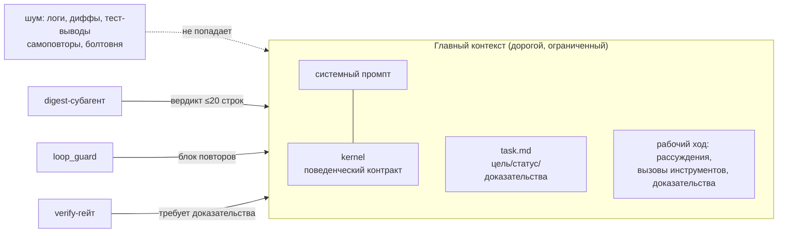
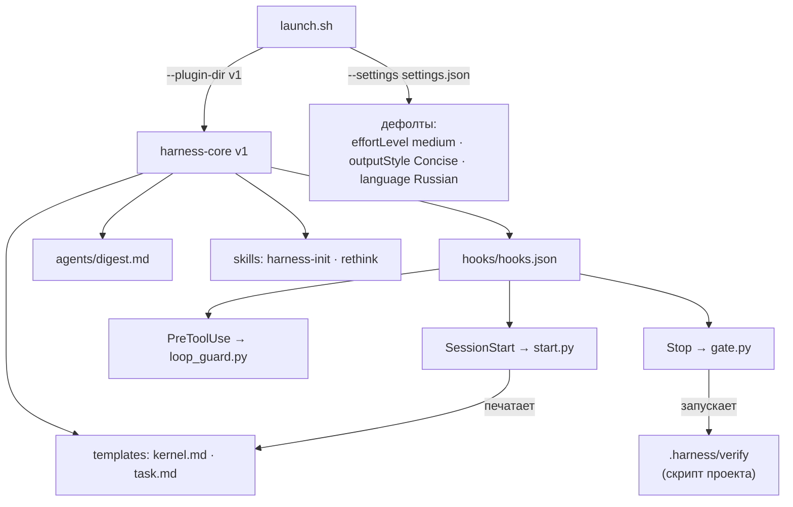
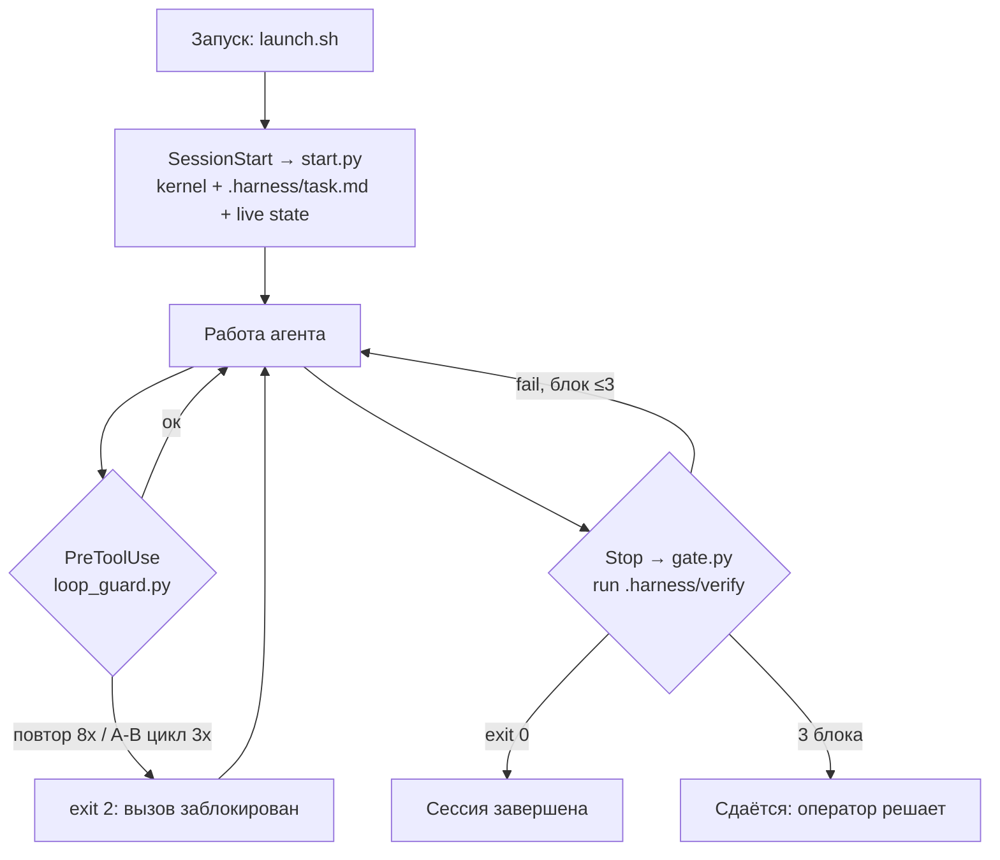
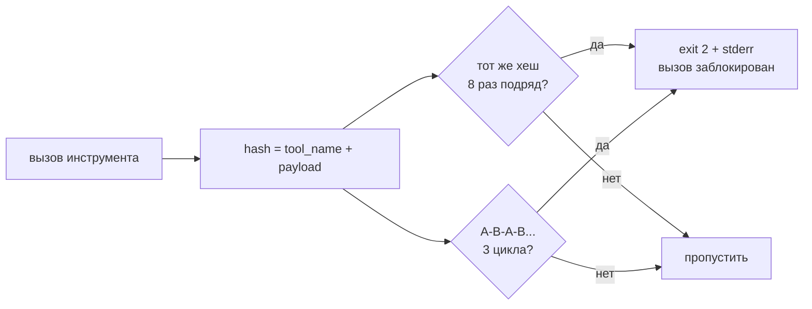

# harness-core-simple

Минимальный харнесс для Claude Code: **3 хука, 1 субагент, 2 скилла**. Всё остальное — нативный Claude Code.
Идея харнесса — **focused context**: главный контекст модели должен содержать только цель, решение и доказательства, а не шум, историю и самоповторы.

## Что такое focused context

`focused context` — это не файл, а **состояние**: что в каждый момент лежит в главном контексте модели (цель, решение, доказательства — и не лежит шум). Его «пишет» сама модель, а харнесс только удерживает: kernel задаёт правила, digest выносит шум, loop_guard режет повторы, Concise режет болтовню.

`task.md` — один из инструментов, а не сам focused context. Пишет его **модель** по правилу kernel (перезаписывать на чекпоинтах, < 40 строк), а `start.py` на SessionStart **читает** его и вливает обратно — так состояние живёт между сессиями, не раздувая контекст.



## Анатомия: что из чего состоит



## Жизненный цикл сессии



## Примитивы под капотом

### 1. kernel (`templates/kernel.md`) — контракт поведения
Инжектится в **каждый** SessionStart (startup, resume, clear, compact, fork) — переживает компакцию контекста. Правила: веди task.md; делегируй шум digest; сверяй покрытие; заканчивай доказательствами, а не мнением. Это единственный постоянный «расход» харнесса на токен — ~10 строк.

### 2. task.md — внешняя память состояния
Модель перезаписывает его на чекпоинтах (этап сделан, решение принято, перед длинной командой, перед стопом): goal, status, evidence, next step, open questions. < 40 строк. `start.py` печатает его целиком + строку state (ветка, dirty, последний гейт) — новая сессия стартует «в тему», а не с нуля.

### 3. loop_guard.py (PreToolUse) — анти-цикл

Хеширует `tool_name + payload`, поэтому Read разных диапазонов — не повтор. Только блок (exit 2), ничего не добавляет в контекст. Пороги: SAME_N=8, PAIR_CYCLES=3, пер-сессия и пер-агент.

### 4. gate.py (Stop) — гейт результата
На попытке остановить сессию гоняет `.harness/verify` (bash-скрипт, которым владеет проект; exit 0 = пройдено). Провал — блок стопа с фидбеком, максимум 3 блока подряд, потом харнесс сдаётся. Обход: `HARNESS_GATE=0`. Смысл: «focused context» без гейта — просто аккуратность; гейт делает доказательства обязательными.

### 5. digest (субагент) — изолятор шума
Запускается в отдельном контексте: съедает `tail`/`grep`/тест-ран на тысячи строк, возвращает вердикт ≤20 строк + путь к сохранённому файлу. Главный контекст платит только за вердикт.

### 6. harness-init — бутстрап проекта
`/harness-core:harness-init`: находит как проект проверяется → пишет исполняемый `.harness/verify` → task.md из шаблона → gitignore-записи → недеструктивный merge дефолтов в `.claude/settings.local.json`. Повторно — только отчёт различий, существующий verify не трогает.

### 7. rethink — адверсариальный режим по вызову
`/harness-core:rethink <идея>`: сверка с файлами (не с памятью) → настоящая цель vs предложенная реализация → критика → альтернативы → вердикт. `disable-model-invocation: true` — модель его не видит вообще (0 токенов до вызова), ничего не редактирует, ≤20 строк.

## Дефолты из коробки

```json
{ "effortLevel": "medium", "outputStyle": "Concise", "language": "Russian" }
```

`/harness-init` мержит их в `.claude/settings.local.json` проекта, значения оператора не перезаписывает. Тот же набор — в `settings.example.json` (для `launch.sh`).
Приоритеты: `--settings` (флаг `launch.sh`) > `.claude/settings.local.json` > `.claude/settings.json` > `~/.claude/settings.json`. Через `launch.sh` язык/стиль менять в его settings-файле.

## Установка и запуск

```bash
# вариант 1: из коробки этого репо
cd /path/to/project && /path/to/harness-core-simple/launch.sh

# вариант 2: плагин в сессию
claude --plugin-dir /path/to/harness-core-simple/v1

# внутри проекта — поднять харнесс
/harness-core:harness-init
```

Требования: git, python3. Проверено на Claude Code 2.1.311: `claude plugin validate`, 39 юнит-тестов, live E2E (`v1/tests/e2e/run.sh`).
Kill switch гейта: `HARNESS_GATE=0`. Тесты: `python3 -m unittest discover -s v1/tests`.
