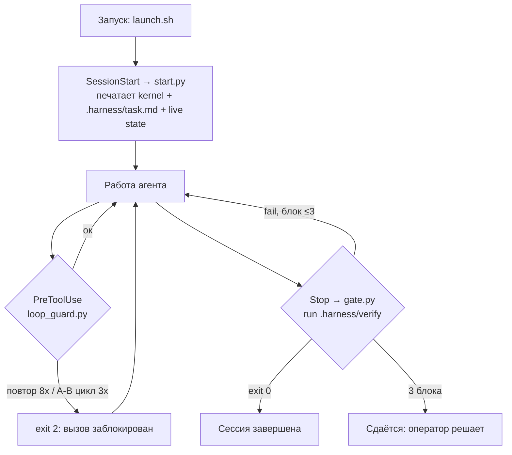
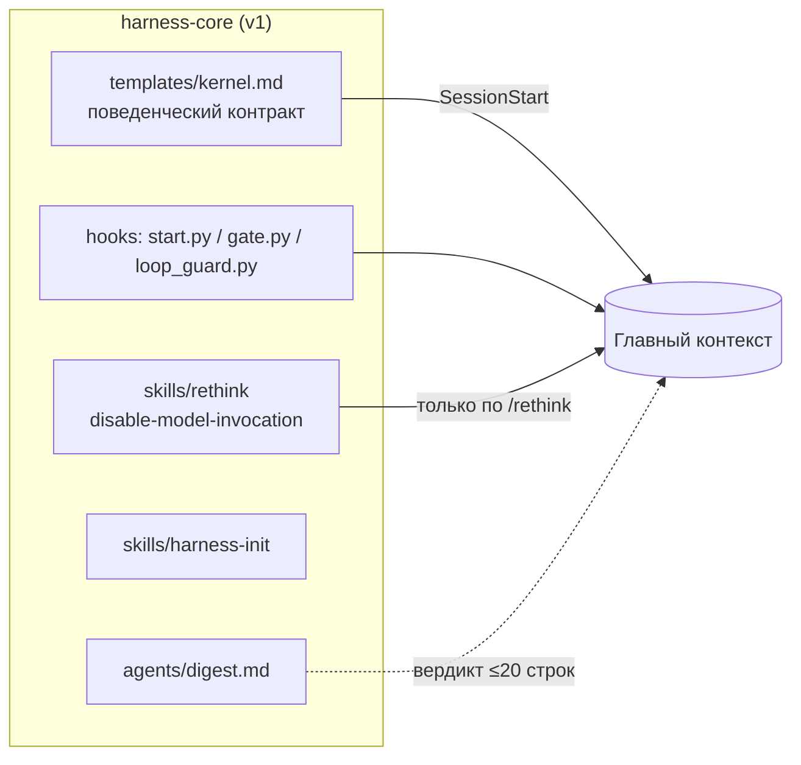

# harness-core-simple

Минимальный харнесс для Claude Code: **3 хука, 1 субагент, 2 скилла**. Всё остальное — нативный Claude Code.
Идея харнесса — **focused context**: главный контекст модели должен содержать только цель, решение и доказательства, а не шум, историю и самоповторы.

## Что такое focused context

`focused context` — это не файл, а **состояние**: что в каждый момент лежит в главном контексте модели (цель, решение, доказательства — и не лежит шум). Его «пишет» сама модель, а харнесс только удерживает: kernel задаёт правила, digest выносит шум, loop_guard режет повторы, Concise режет болтовню.

`task.md` — один из инструментов, а не сам focused context. Пишет его **модель** по правилу kernel (перезаписывать на чекпоинтах, < 40 строк), а `start.py` на SessionStart **читает** его и вливает обратно — так состояние живёт между сессиями, не раздувая контекст.

## Вокруг чего он крутится

| Утечка контекста | Что делает харнесс |
|---|---|
| Модель забывает цель и что уже сделано | `.harness/task.md` — внешнее состояние: цель, статус, доказательства, следующий шаг (перезаписывается, < 40 строк) |
| Шумный вывод (логи, тесты, grep) затапливает контекст | субагент `harness-core:digest` — шум обрабатывается в изолированном контексте, в главный возвращается вердикт ≤20 строк |
| Runner-циклы (одинаковые вызовы по кругу) | `loop_guard.py` (PreToolUse): блок 8 идентичных вызовов или 3 A-B цикла подряд |
| «Готово» без доказательств | гейт на Stop: `.harness/verify` (твой скрипт), стоп блокируется до прохождения (макс 3 раза) |
| Болтливость модели | дефолт `outputStyle: Concise` |
| Модель начинает спорить/усложнять до кода | ручной `/rethink` (0 токенов до вызова) — адверсариальный разбор идеи оператора |

## Жизненный цикл сессии



## Из чего состоит



## Дефолты из коробки

`/harness-init` (шаг 7) недеструктивно мержит в `.claude/settings.local.json` проекта:

```json
{ "effortLevel": "medium", "outputStyle": "Concise", "language": "Russian" }
```

Существующие значения оператора не перезаписываются. Тот же набор — в `settings.example.json` (для `launch.sh`).
Важно про приоритеты: `--settings` (флаг `launch.sh`) > `.claude/settings.local.json` > `.claude/settings.json` > `~/.claude/settings.json`. Если запускаешь через `launch.sh`, язык/стиль надо менять в его settings-файле.

## Установка и запуск

```bash
# вариант 1: из коробки этого репо
cd /path/to/project && /path/to/harness-core-simple/launch.sh

# вариант 2: плагин в сессию
claude --plugin-dir /path/to/harness-core-simple/v1

# внутри проекта — поднять харнесс
/harness-core:harness-init
```

Требования: git, python3. Проверено на Claude Code 2.1.311: `claude plugin validate`, 39 юнит-тестов, live E2E (`v1/tests/e2e/run.sh`).
Kill switch гейта: `HARNESS_GATE=0`. Тесты: `python3 -m unittest discover -s v1/tests`.

## Скиллы

- **`/harness-core:harness-init`** — подключает репозиторий: `.harness/verify`, task.md, gitignore-записи, дефолты настроек. Повторный запуск безопасен.
- **`/harness-core:rethink <идея>`** — адверсариальный разбор идеи до реализации: сверка с файлами, настоящая цель, критика, альтернативы, вердикт. Ничего не редактирует, ≤20 строк, не виден модели (0 токенов).
